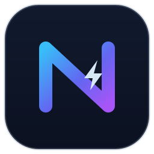
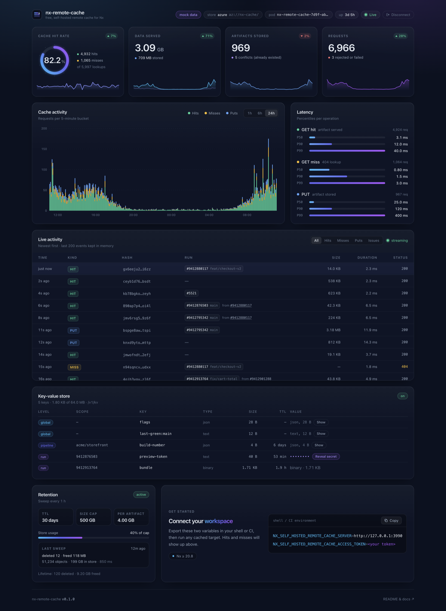
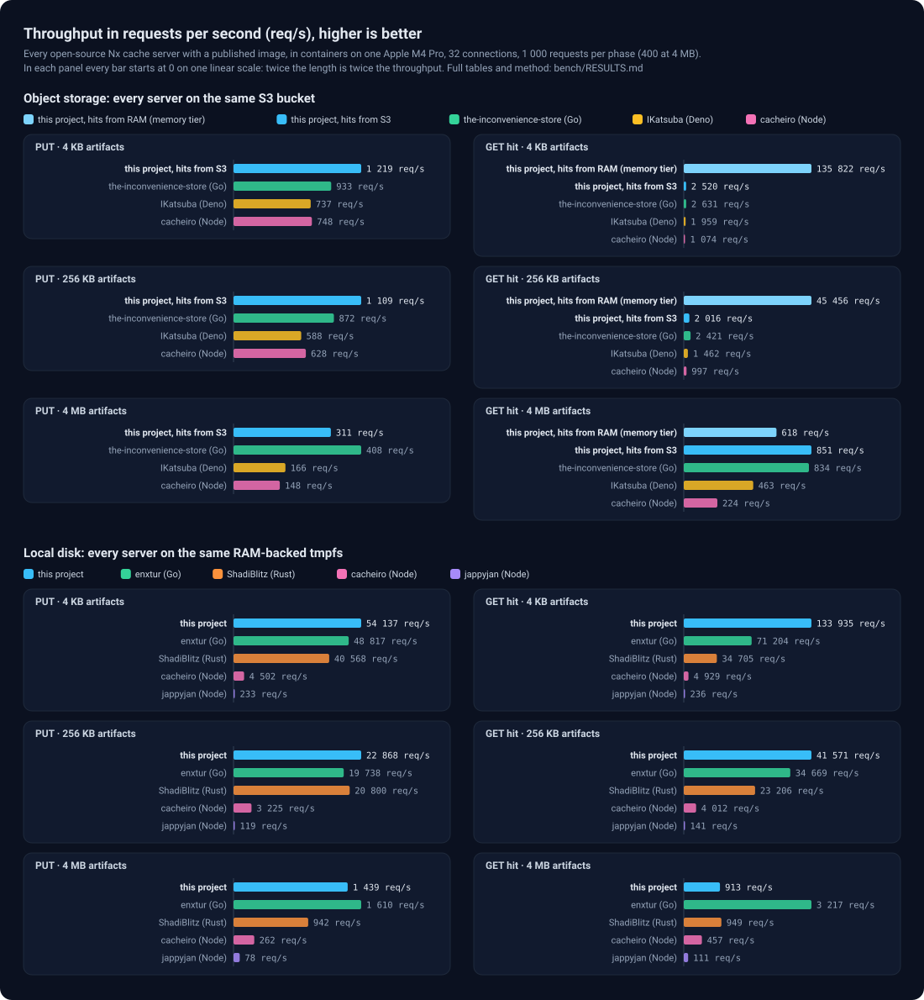

<p align="center">
  
</p>

<h1 align="center">nx-remote-cache</h1>

<p align="center">
  <b>A free, self-hosted remote cache for Nx. Small, fast, yours.</b><br>
  One 4 MB binary. Azure Blob, S3, GCS or a disk behind it. A live dashboard in front of it.<br>
  <sub>Independent open-source project, MIT. Not affiliated with or endorsed by Nx or Narwhal Technologies; Nx and Nx Cloud are their trademarks.</sub>
</p>

<p align="center">
  <a href="https://github.com/MisterPandaPooh/nx-remote-cache/actions/workflows/ci.yml"></a>
  <a href="https://github.com/MisterPandaPooh/nx-remote-cache/pkgs/container/nx-remote-cache"></a>
  <a href="https://hub.docker.com/r/misterpandapooh/nx-remote-cache"></a>
  <a href="https://github.com/MisterPandaPooh/nx-remote-cache/pkgs/container/charts%2Fnx-remote-cache"></a>
  
  
</p>

<p align="center">
  
</p>

## Two goals

1. **Nx Cloud-class caching on storage you already own, for free.** Every `nx` run on every
   machine and in CI shares one cache in your own bucket. No seats, no vendor, no data leaving
   your cloud. It speaks the official [Nx self-hosted cache API](https://nx.dev/docs/kb/self-hosted-caching),
   verified byte for byte against the published OpenAPI spec.
2. **Nothing to operate.** One container, one store URL, one token. Retention, metrics, probes
   and a dashboard are built in. Deploy with one `helm install`; it runs as a non-root `scratch`
   image and restarts in milliseconds.

## What makes it strong

- **Fastest in its class.** Rust on hyper and tokio, streaming in both directions, hot artifacts
  served from RAM. Measured against every other open-source Nx cache server on the same machine:
  [benchmark](#benchmark).
- **Any store, one URL.** `az://` (Workload Identity, managed identity, SAS, key, Azurite),
  `s3://` (IRSA, keys, MinIO, R2), `gs://`, `file://`, `memory:///`. Credentials come from the
  provider's standard variables.
- **Safe by default.** Read-write and read-only tokens compared in constant time, so pull
  requests can read but never poison the cache ([CREEP, CVE-2025-36852](SECURITY.md)). Strict CSP,
  signed images with SBOM and provenance, no shell in the container.
- **A dashboard that explains your cache.** Hit rate, throughput, latency percentiles, retention,
  and a live feed where every artifact links to the CI run that produced it and the one that reused it.
- **Kubernetes-native.** Helm chart on the Bitnami `common` library with typed values per store,
  Prometheus metrics, liveness and readiness probes, graceful drain, PDB, HPA.
- **Bounded by design.** Memory for uploads is a formula you set, never "whatever the body is".
  A 2 GB artifact costs the same RAM as a 2 KB one.
- **A little extra.** `/v1/kv`, a small key-value store for CI glue (flags, last green commit,
  a token for the next job), scoped per run or per repository, secrets readable only with the
  read-write token and masked in the dashboard;
  and a composite action that caches any path like `actions/cache`, against your own server
  ([`actions/`](actions/README.md)).

## Benchmark

<p align="center"></p>

Every open-source Nx cache server with a published image, each on every store it supports, in
containers on one machine, 32 connections, same S3 bucket or same RAM-backed disk, from 4 KB to
1 GB artifacts. First on uploads and on small and medium hits in both arenas, and 20 to 50× ahead on hot hits from its
memory tier (artifacts kept in RAM, something no other server does). Two honest losses: the Go servers lead on 4 MB uploads to S3 (about 25 %) and on
4 MB hits from disk (3.5×, `sendfile`). Method, full tables, and why:
[`docs/performance.md`](docs/performance.md).

## First run

### Try it in thirty seconds

No token, no cloud, artifacts on a tmpfs:

```bash
docker run --rm -p 3000:3000 \
  -e NX_CACHE_STORE_URL=file:///data -e NX_CACHE_ENABLE_LOGIN=false \
  --tmpfs /data:uid=65534,gid=65534 \
  ghcr.io/misterpandapooh/nx-remote-cache:latest
```

Open <http://localhost:3000> for the dashboard, then point Nx (≥ 20.8) at it:

```bash
export NX_SELF_HOSTED_REMOTE_CACHE_SERVER=http://localhost:3000
export NX_SELF_HOSTED_REMOTE_CACHE_ACCESS_TOKEN=anything   # Nx insists on a value
nx run-many -t build
```

Anything reachable by other people needs tokens: drop `NX_CACHE_ENABLE_LOGIN=false`, set
`NX_CACHE_TOKEN` for trusted branches and `NX_CACHE_READ_TOKEN` for pull requests.

### S3, MinIO, Cloudflare R2

```bash
docker run --rm -p 3000:3000 \
  -e NX_CACHE_STORE_URL=s3://my-bucket/nx-cache \
  -e AWS_REGION=eu-west-1 -e AWS_ACCESS_KEY_ID=… -e AWS_SECRET_ACCESS_KEY=… \
  -e NX_CACHE_TOKEN="$(openssl rand -hex 32)" -e NX_CACHE_READ_TOKEN="$(openssl rand -hex 32)" \
  ghcr.io/misterpandapooh/nx-remote-cache:latest
```

Add `-e AWS_ENDPOINT=https://…` for MinIO or R2 (`AWS_ALLOW_HTTP=true` for plain http).
On Kubernetes, with an IAM role (IRSA) and generated tokens:

```bash
helm install nx-remote-cache oci://ghcr.io/misterpandapooh/charts/nx-remote-cache \
  --namespace nx-remote-cache --create-namespace \
  --set store.type=s3 --set store.s3.bucket=my-bucket --set store.s3.region=eu-west-1 \
  --set store.s3.irsa.roleArn=arn:aws:iam::123456789012:role/nx-remote-cache \
  --set ingress.enabled=true --set ingress.hostname=nx-cache.example.com --set ingress.tls=true
```

### Azure Blob

```bash
docker run --rm -p 3000:3000 \
  -e NX_CACHE_STORE_URL=az://nx-cache/ \
  -e AZURE_STORAGE_ACCOUNT_NAME=mystorageaccount -e AZURE_STORAGE_ACCOUNT_KEY=… \
  -e NX_CACHE_TOKEN="$(openssl rand -hex 32)" -e NX_CACHE_READ_TOKEN="$(openssl rand -hex 32)" \
  ghcr.io/misterpandapooh/nx-remote-cache:latest
```

On AKS, with Workload Identity (no key leaves Azure; grant the identity *Storage Blob Data
Contributor* on the container):

```bash
helm install nx-remote-cache oci://ghcr.io/misterpandapooh/charts/nx-remote-cache \
  --namespace nx-remote-cache --create-namespace \
  --set store.type=azure --set store.azure.accountName=mystorageaccount \
  --set store.azure.workloadIdentity.clientId=<managed identity client id> \
  --set ingress.enabled=true --set ingress.hostname=nx-cache.example.com --set ingress.tls=true
```

Google Cloud Storage, a persistent volume, SSO in front of the dashboard, GitHub Actions wiring:
[`docs/deploy.md`](docs/deploy.md), [`docs/ci.md`](docs/ci.md). The install prints how to read
the generated tokens back.

## Documentation

| | |
|---|---|
| [`docs/deploy.md`](docs/deploy.md) | Helm, Kubernetes manifests, every store and its credentials, retention |
| [`docs/configuration.md`](docs/configuration.md) | Every environment variable, with units and sizing notes |
| [`docs/ci.md`](docs/ci.md) | GitHub Actions workflow, linking artifacts to CI runs, the composite cache action |
| [`docs/dashboard.md`](docs/dashboard.md) | Dashboard, JSON API, Prometheus, logs |
| [`docs/api.md`](docs/api.md) | HTTP API: cache endpoints, dashboard API, key-value store |
| [`docs/kv.md`](docs/kv.md) | Key-value store guide |
| [`docs/performance.md`](docs/performance.md) | Benchmark method, tables, what makes the difference |
| [`docs/architecture.md`](docs/architecture.md) | How it is built, spec conformance, developing and testing |
| [`docs/release.md`](docs/release.md) | Versioning, what a release publishes, signatures |
| [`charts/nx-remote-cache/`](charts/nx-remote-cache/README.md) | Helm chart values |
| [`SECURITY.md`](SECURITY.md) | Threat model, cache poisoning, hardening, reporting |
| [`CHANGELOG.md`](CHANGELOG.md), [`CONTRIBUTING.md`](CONTRIBUTING.md) | |

## License

MIT.
