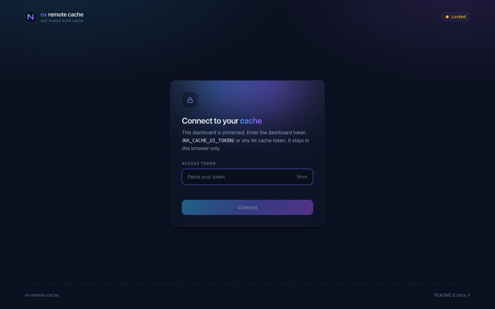

<p align="center">
  
</p>

<h1 align="center">nx-remote-cache</h1>

<p align="center">
  <b>A free, open-source, self-hosted remote cache for Nx that is small, fast and boring to run.</b><br>
  <i>One 4 MB static binary. Azure Blob, S3, GCS or local disk behind it. A dashboard in front of it.</i><br>
  Implements the official <a href="https://nx.dev/docs/kb/self-hosted-caching">Nx self-hosted cache API</a>, byte for byte, with a conformance test that walks the published OpenAPI spec.<br>
  <sub>An independent community project, not affiliated with or endorsed by Nx or Narwhal Technologies. Nx and Nx Cloud are their trademarks.</sub>
</p>

<table align="center">
  <tr>
    <td align="center" width="25%"><h3>⚡</h3></td>
    <td align="center" width="25%"><h3>☁️</h3></td>
    <td align="center" width="25%"><h3>📊</h3></td>
    <td align="center" width="25%"><h3>🔒</h3></td>
  </tr>
  <tr>
    <td align="center" valign="top"><b>Built for the hot path</b><br><sub>Streaming in both directions, create-only writes, an in-memory tier for hot artifacts, sub-millisecond misses</sub></td>
    <td align="center" valign="top"><b>Any object store</b><br><sub>Azure Blob first (Workload Identity, SAS, key, Azurite), plus S3, GCS, local disk and memory, one URL to switch</sub></td>
    <td align="center" valign="top"><b>Built-in dashboard</b><br><sub>Hit rate, throughput, latency percentiles, retention, live events linked to the CI run that produced them</sub></td>
    <td align="center" valign="top"><b>Kubernetes-native</b><br><sub>Scratch image, non-root, health and readiness probes, Prometheus metrics, graceful drain, manifests included</sub></td>
  </tr>
</table>

<p align="center">
  <a href="https://github.com/MisterPandaPooh/nx-remote-cache/actions/workflows/ci.yml"></a>
  <a href="https://github.com/MisterPandaPooh/nx-remote-cache/pkgs/container/nx-remote-cache"></a>
  
  
  
</p>

<p align="center">
  
</p>

## Why

Nx can push task outputs to any server that speaks two HTTP calls: `PUT /v1/cache/{hash}` and
`GET /v1/cache/{hash}`. Nx Cloud does that and much more; the community servers do it in Deno or Go
with a single backend. This one is written in Rust around three ideas:

1. **Never hold an artifact in memory.** Uploads stream into multipart writes, downloads stream out
   of the store. A 2 GB `node_modules` snapshot costs the same RAM as a 2 KB lint result.
2. **Reads are the product.** Misses answer in well under a millisecond, hits for small artifacts
   come straight from an LRU in memory, and every answer the Nx client could misread (409, 403, 413)
   is delivered reliably, because the request body is drained before responding.
3. **Nothing to operate.** One binary, one URL for the store, one token. Retention is a lifecycle
   policy on the bucket or a built-in sweeper. The dashboard is embedded in the same binary.

## Quick start

```bash
docker run --rm -p 3000:3000 \
  -e NX_CACHE_STORE_URL=file:///data -e NX_CACHE_TOKEN=dev-token \
  --tmpfs /data:uid=65534,gid=65534 \
  ghcr.io/misterpandapooh/nx-remote-cache:latest
```

Point Nx (≥ 20.8) at it:

```bash
export NX_SELF_HOSTED_REMOTE_CACHE_SERVER=http://localhost:3000
export NX_SELF_HOSTED_REMOTE_CACHE_ACCESS_TOKEN=dev-token
nx run-many -t build
```

Open <http://localhost:3000> and paste the token: that is the dashboard.

Production is one `kubectl apply -k deploy/k8s`: two replicas, probes, non-root, read-only root
filesystem, an Ingress sized for big artifacts, Azure Blob with Workload Identity (no key leaves
Azure), or S3, GCS and plain volumes behind the same URL. Walkthrough: [`docs/deploy.md`](docs/deploy.md).

## Performance

<p align="center"></p>

Every server in a container on the same machine, same S3 bucket or same RAM-backed disk, 32
connections. On object storage, the arena that matters in production, the Rust server uploads
1.6 to 2.5× faster than the Deno server, answers misses 25 to 50 % sooner and serves hot
artifacts from its memory tier 25 to 70× faster. Against the Go server on local disk it is a tie
or ahead everywhere except large hits from disk, where `sendfile(2)` wins. Why, the full tables
and how to rerun: [`docs/performance.md`](docs/performance.md), [`bench/RESULTS.md`](bench/RESULTS.md).

## What you get

- **Any object store.** Azure Blob (Workload Identity, managed identity, SAS, key, Azurite),
  S3 / MinIO / R2, Google Cloud Storage, local disk, memory. One URL to switch. [`docs/deploy.md`](docs/deploy.md)
- **A dashboard in the same binary.** Hit rate, 24 h activity, latency p50/p90/p99, retention,
  a live feed where every artifact links to the CI run that produced it and the one that reused
  it. Guarded by a token or your SSO proxy. [`docs/dashboard.md`](docs/dashboard.md)
- **CI integration.** A complete GitHub Actions workflow (read-only token on pull requests, so a
  fork cannot poison the cache), artifacts tagged with their run, and an `actions/cache`-like
  composite action for anything outside Nx. [`docs/ci.md`](docs/ci.md)
- **Retention.** Lifecycle policies for Azure, S3 and GCS, plus a built-in sweeper for size
  budgets, local disk and sub-day TTLs. [`docs/deploy.md#retention`](docs/deploy.md#retention)
- **Observability.** Prometheus metrics, structured JSON logs with levels, liveness and
  readiness probes. [`docs/dashboard.md`](docs/dashboard.md)
- **Key-value store.** `/v1/kv`: a small LRU store for CI glue (flags, last green commit, a
  JSON blob between jobs), with TTLs and content types. [`docs/kv.md`](docs/kv.md)
- **Spec conformance.** A test walks the OpenAPI document published by Nx against the live
  router and fails on any difference. [`docs/architecture.md`](docs/architecture.md)

<p align="center"></p>

## Security

Bearer tokens compared in constant time, read-write and read-only; hashes validated; uploads
size- and concurrency-capped; credentials never logged; a strict CSP on the dashboard; a
`scratch` image running as non-root with a read-only filesystem. Threat model, hardening
details and how to report a vulnerability: [`SECURITY.md`](SECURITY.md).

## Documentation

| | |
|---|---|
| [`docs/deploy.md`](docs/deploy.md) | Kubernetes walkthrough, every store and its credentials, retention |
| [`docs/configuration.md`](docs/configuration.md) | Every environment variable, with units and sizing notes |
| [`docs/ci.md`](docs/ci.md) | GitHub Actions workflow, linking artifacts to CI runs, the composite cache action |
| [`docs/dashboard.md`](docs/dashboard.md) | Dashboard, JSON API, Prometheus, logs |
| [`docs/api.md`](docs/api.md) | HTTP API: cache endpoints, dashboard API, key-value store |
| [`docs/kv.md`](docs/kv.md) | Key-value store guide |
| [`docs/performance.md`](docs/performance.md) | Benchmark method, tables, what makes the difference |
| [`docs/architecture.md`](docs/architecture.md) | How it is built, spec conformance, developing and testing |
| [`docs/nx-internals.md`](docs/nx-internals.md) | How the Nx client talks to a remote cache, read from its sources |
| [`deploy/sso/`](deploy/sso/README.md) | Dashboard behind Keycloak, SAML or Kong |
| [`CHANGELOG.md`](CHANGELOG.md), [`CONTRIBUTING.md`](CONTRIBUTING.md) | |

## License

MIT. An independent community project, not affiliated with or endorsed by Nx or Narwhal
Technologies; Nx and Nx Cloud are their trademarks.
